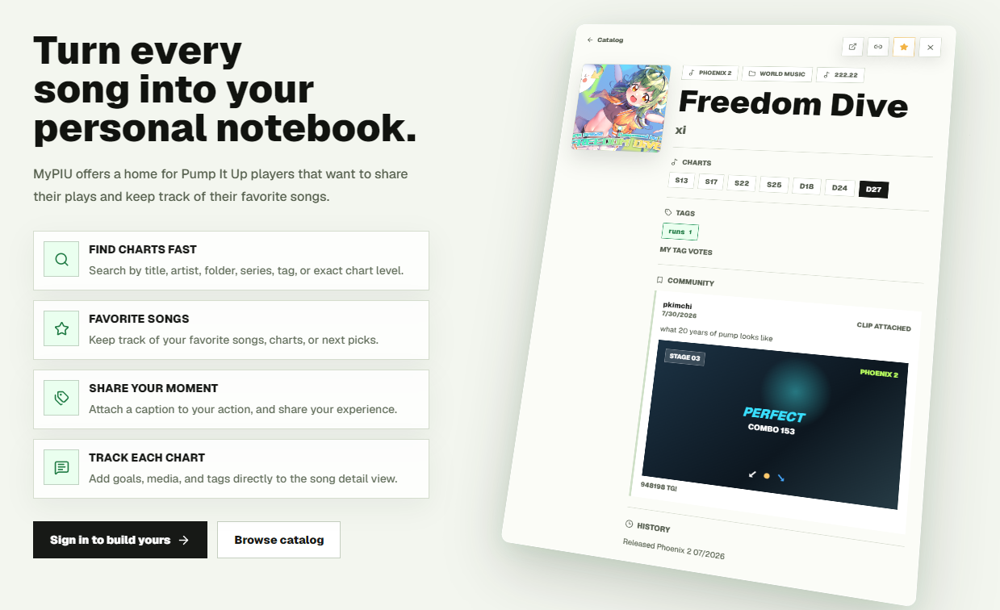

# MyPIU

[](https://mypiu.austin.kim)
[](https://github.com/austinkimchi/piugame-web/actions/workflows/web-checks.yml)


MyPIU is a Pump It Up song catalog and personal performance notebook. Find charts, preview songs, and keep track of what you are learning and clearing at [mypiu.austin.kim](https://mypiu.austin.kim).

## Features

- Search by title, artist, folder, series, tag, or chart level.
- Browse version-specific charts, catalog history, jackets, and audio previews.
- Save favorites and add notes, tags, and community posts to songs and charts.
- Connect your PIUGAME account to view recent plays, performance history, and chart recommendations.
- Share account and catalog features with the [native apps and browser extensions](https://github.com/austinkimchi/piugame-mobile).

## Preview



## Getting started

Visit [MyPIU](https://mypiu.austin.kim) to browse the catalog. Sign in to save favorites and use personal features.

For local development, use Node 24 and [GitHub Packages read access](docs/ci.md#local-package-access) for the private SDK:

```sh
npm ci
npm run dev
```

Open [localhost:4080](http://localhost:4080). Without `MONGODB_URI`, the site shows a limited fallback catalog. For full development, copy `.env.example` to `.env.local` and configure a disposable MongoDB database and development login providers. Keep production credentials out of local tests.

## Development

Read [AGENTS.md](AGENTS.md), then run the relevant checks:

```sh
npm test
npx --no-install next typegen
npx --no-install tsc --noEmit --incremental false
npm run build
```

[Web checks](docs/ci.md) validate code changes on Ubuntu. The live site's existing systemd deployment follows `main`; see the [maintenance runbook](docs/maintenance.md) before merging or updating catalog data.

## Project notes

- [Architecture, catalog updates, audio, and deployment](docs/maintenance.md)
- [CI and spending controls](docs/ci.md)
- [Mobile API](docs/mobile-api.md) · [Sign in with Apple](docs/sign-in-with-apple.md)
- [PIUGAME SDK](https://github.com/austinkimchi/piugame-sdk) · [Mobile project](https://github.com/austinkimchi/piugame-mobile)

MyPIU is not affiliated with ANDAMIRO.
